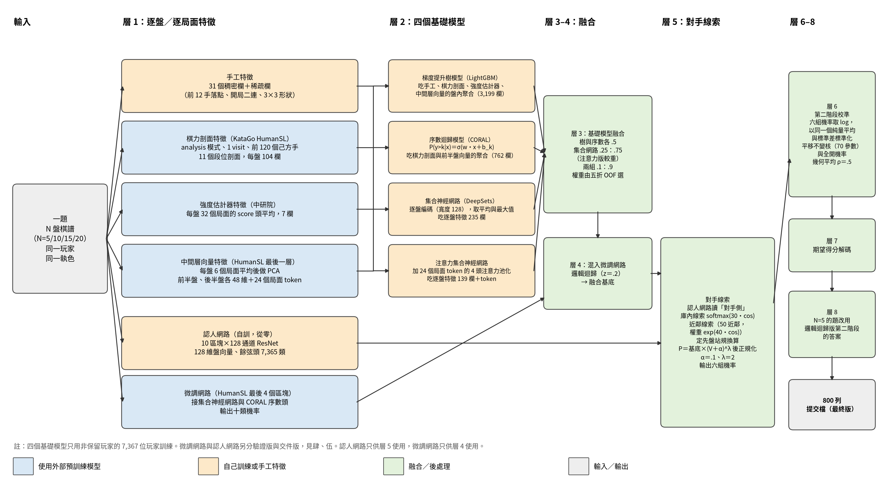

# aicup2026-go-rank

這是 AI CUP 2026 秋季賽「圍棋棋力與風格預測競賽」競賽二（Rank）的程式碼。題目是給同一位玩家的一組棋譜，預測他屬於十個段位中的哪一個。

我們把每盤棋轉成數字特徵，讓幾種不同類型的模型各自判斷，再合併成最後的答案。這個 repo 有資料處理、訓練、預測的程式，也有重現最終提交檔的 Colab 筆記本。

English: code for AI CUP 2026 Go, task 2 (predict a player's rank level from a set of games). GPL-3.0.

另一題（辨識玩家）放在 [aicup2026-go-player](https://github.com/Jadiouo/aicup2026-go-player)。兩個 repo 可以各自安裝、測試和執行。

## 成績

| | Public | Private |
|---|---|---|
| 名次 | 第 30 名 | 第 29 名 |
| 分數 | 0.7568017 | 0.7286153 |

每題猜中段位得 1 分，差一級得 e⁻¹（約 0.368）分，差兩級以上得 0 分，榜上分數是各題平均。

## 方法概述

每題是同一位玩家、同一執色的 5 到 20 盤棋，要預測他屬於 D、C、B、A、1D 到 6D 這十個段位的哪一個。我們先把每盤棋轉成特徵，來源有手工特徵、KataGo HumanSL 的落子統計、強度估計器分數和 KataGo 主幹向量，另外還微調了一個 HumanSL 網路直接輸出段位機率。四個基礎模型各自判斷，分別是梯度提升樹、序數迴歸和兩種集合神經網路，再融合成一組機率。接著用我們自己訓練的認人網路去認出對手是誰，把對手已知的段位當作線索加進來。最後用第二階段分類器校準六組機率，並選期望得分最高的段位，而不是機率最高的那一級。



## 快速開始

重現最終提交檔只需要 CPU，Colab 免費版就能跑完，約 5 分鐘。最後一步不需要官方原始棋譜。

1. 在 Colab 選 File → Open notebook → GitHub，貼上 `https://github.com/Jadiouo/aicup2026-go-rank`，開啟 `colab/reproduce_final.ipynb`。
2. 把第一格的 `INTERMEDIATE_DIR` 指到放中間檔的資料夾，例如掛載的 Google Drive。`REPO_URL` 和 `RELEASE_URL` 已經填好。
3. Runtime → Run all。筆記本會安裝鎖定版本的套件，從 Release 下載自訓權重，驗證中間檔，然後跑最後一步。
4. 結尾會印出提交檔的 sha256，應該是 `3a9525a3e7e6273727d0e5fd0a6fc7d5fc2921b17c7687b36f83e961c9d13919`。

自訓權重會自動從這個 repo 的 Release 下載。由官方棋譜算出來的中間檔不公開，需要向主辦單位索取，或照 [PIPELINE.md](PIPELINE.md) 自己產生。

筆記本在本機用 `jupyter nbconvert --execute` 實際跑過，結果逐位元組相符。還沒有在真正的 Colab 上跑過。Colab 的 Python 和套件版本可能和鎖定版本不同，如果 pip 提示重新啟動，照做後從頭再跑一次。

本機安裝與跑測試：

```bash
python3.12 -m venv .venv
.venv/bin/python -m pip install -r requirements.txt
.venv/bin/python -m pytest -q
```

## 目錄結構

```
README.md              本檔
PIPELINE.md            管線的步驟、輸入輸出、耗時，以及逐元件的訓練與推論指令
ASSETS.md              權重與中間檔的清單，含大小與 sha256
LICENSE                GPL-3.0 全文
requirements.txt       CPU 環境（鎖定版本）
requirements-gpu.txt   GPU 環境（torch 2.12.0 等）
docs/                  README 用的架構圖
src/gogame/            共用程式庫：SGF 解析、棋盤、特徵、聚合、模型、提交檔寫入與檢查
tests/                 單元測試，用合成棋譜，不含官方資料
scripts/               各階段腳本，eNN 是實驗編號，katago/ 是 HumanSL 掃描
final/                 最後一步：六組機率經第二階段，組成最終提交檔
colab/                 Colab 筆記本、colab_utils.py、assets_manifest.json
```

`scripts/` 沒有再拆資料夾，因為腳本之間用相對位置 import，搬動會弄壞。

## 從頭重新訓練

從官方棋譜整條重跑，GPU 約需 71 小時以上，另外微調網路的輸入編碼在學校 CPU（4 個行程）約需 70 小時。這是已知分項相加的結果，沒有整條量過，棋力剖面掃描約 100 萬盤另計。Colab 免費版跑不完。

能直接重跑的是「中間檔到最終 CSV」這一段。更上游的每一步都有程式和指令，寫在 [PIPELINE.md](PIPELINE.md)。GPU 的結果不會位元重現，所以自己重算的中間檔和主辦方拿到的那份不會完全一樣，已知限制也列在 PIPELINE.md。

## 資料與權重

- 自訓權重共 5 個檔、167.2 MB，放在這個 repo 的 [Release v1.0](https://github.com/Jadiouo/aicup2026-go-rank/releases/tag/v1.0)。
- 由官方棋譜算出的中間檔共 14 個檔、1129.9 MB，不放在 repo 或 Release，可應主辦單位要求以私人連結提供。
- 官方棋譜本身不附。外部模型（KataGo、HumanSL、Strength Estimator）也不散布，下載網址與放置路徑見 [ASSETS.md](ASSETS.md) 第 3 節。
- 逐檔的大小與 sha256 在 ASSETS.md，機器可讀版是 `colab/assets_manifest.json`。

## 授權

本 repo 採 GPL-3.0，全文見 [LICENSE](LICENSE)。其中 `scripts/experiments/e21/se_encode.py` 依 Strength Estimator（GPL-3.0）和 MiniZero（Apache-2.0）公開原始碼的行為，用 Python 重寫了輸入平面轉換，並非逐字複製。選用 GPL-3.0 與此相容。

第三方元件不在本 repo 內，只有下載連結：

- KataGo 程式：MIT 式授權（Copyright David J Wu (lightvector) and/or other authors），`cpp/external` 內的第三方元件各有授權。
- KataGo 網路（kata1 與 Human SL）：KataGo Neural Network License，MIT 式。我們微調 HumanSL 檢查點得到的權重（`final_s0`、`ft4_s0`）也要遵守它。
- Strength Estimator：程式庫是 GPL-3.0，權重沒有看到明確授權。我們只從權利人的公開頁面下載使用，不再散布。
- MiniZero：Apache-2.0。
- 使用的開源套件：numpy、scipy、pandas、pyarrow、scikit-learn、LightGBM、PyTorch、sgfmill、PyYAML、numba。

## 生成式 AI 使用

開發過程使用 Claude Code（Anthropic）協助撰寫與審查程式、實驗與文件。
